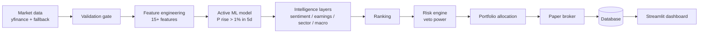

# AI Stock Trader

A **paper-trading system** that uses machine learning to rank US stocks, applies strict risk rules, and runs the whole loop automatically every trading day, with a Streamlit dashboard to monitor it.

> **Paper trading only.** There is no real-money or live-broker code in this project. Nothing here is financial advice.


---

## What it does

Every trading day the pipeline:

1. Pulls market data (Yahoo Finance, with a fallback provider) and **validates** it before anything uses it
2. Computes scale-invariant technical features (trend, momentum, RSI, MACD, volatility, volume, relative strength vs SPY)
3. Scores each stock with an ML model: *probability the stock rises more than 1% over the next 5 trading days*
4. Adjusts scores with news sentiment, earnings proximity, sector rotation and macro regime
5. Runs everything through a **risk engine** with veto power (stop-loss, take-profit, position cap, cash reserve, market regime filter)
6. Simulates fills with transaction costs and slippage, stores everything in a database, and shows it on a dashboard

## Key features

- **Leakage-safe ML**: features use only past data, labels are isolated per ticker, and a 5-day embargo gap separates train and test sets. Adversarial leakage tests are part of the suite.
- **Honest evaluation**: walk-forward validation across 2021 bull, 2022 bear, 2023 rebound and 2024 late-cycle regimes. Reports edge over the base rate, flags small samples (N < 30), and raises an alarm on "too good to be true" metrics.
- **Risk engine with veto power**: -8% stop-loss, +15% take-profit, signal exit below 0.45, max 3 positions, 15% cash reserve, minimum trade size.
- **Market regime filter**: no new buys when SPY is below its 200-day moving average, plus crash circuit breakers (SPY -5% in 5 days or -10% in 20 days).
- **Intelligence layers**: VADER news sentiment, earnings blackout windows, sector rotation ranking, and FRED macro indicators.
- **Explainability and monitoring**: SHAP explanations per prediction and PSI-based model drift alarms that cut position size or pause buying.
- **Human-in-the-loop promotion**: models are never auto-promoted; a person reviews the evaluation report and runs the promotion step.
- **Hands-off operation**: Windows Task Scheduler jobs for the daily run, a morning health check, daily status digest and dashboard launch, with missed-run detection.
- **Data validation gate**: rejects impossible prices, volatility-aware spike detection, and NYSE-calendar-aware gap checks.
- **Storage**: SQLAlchemy repository layer with SQLite by default and PostgreSQL by changing one setting.

## Architecture



## Strategy parameters

All defaults live in `config/settings.py` and can be overridden through `.env`.

| Parameter | Default |
|---|---|
| Starting capital | $10,000 (paper) |
| Prediction horizon / win threshold | 5 trading days / +1% |
| Buy bar / signal exit | P ≥ 0.60 / P < 0.45 |
| Stop-loss / take-profit | -8% / +15% |
| Max positions / cash reserve | 3 / 15% |
| Simulated cost per trade | 0.2% |
| Regime filter | SPY 200-day moving average |
| Universe | 25 large-cap US stocks across 8 sectors, benchmark SPY |

## Tech stack

| Area | Tools |
|---|---|
| Language | Python 3.11 |
| Data | pandas, numpy, yfinance, Alpha Vantage, pandas-market-calendars |
| ML | scikit-learn (HistGradientBoosting, Logistic Regression), XGBoost, LightGBM, SHAP, Optuna |
| NLP / alerts | VaderSentiment, python-telegram-bot, Google GenAI |
| Storage | SQLAlchemy, SQLite / PostgreSQL |
| Dashboard | Streamlit, Plotly |
| Scheduling | Windows Task Scheduler (PowerShell), APScheduler |
| Config / tests | pydantic-settings, python-dotenv, pytest |

## Project structure

```
ai-stock-trader/
├── config/          # Central settings (the only place env vars are read)
├── src/
│   ├── data/        # Market data fetching + validation gate
│   ├── features/    # Feature engineering
│   ├── ml/          # Dataset/labels, training, walk-forward evaluation
│   ├── ranking/     # Opportunity ranking and conviction tiers
│   ├── risk/        # Risk engine (stops, caps, regime filter)
│   ├── portfolio/   # Order sizing and fee accounting
│   ├── trading/     # Paper broker
│   ├── backtest/    # Day-by-day backtesting engine
│   ├── pipeline/    # Daily pipeline orchestrator and scheduler
│   └── db/          # ORM models and repository layer
├── dashboard/       # Streamlit monitoring dashboard
├── tests/           # pytest suite
├── data/            # Raw snapshots, processed data, trained models (git-ignored)
└── reports/         # Generated reports
```

## Getting started

### Prerequisites
- Python 3.11
- Windows is recommended for the scheduler scripts (`.bat` / `.ps1`). The core pipeline and dashboard run anywhere Python does.

### Install

```bash
git clone https://github.com/praneeth-hari/ai-stock-trader.git
cd ai-stock-trader

python -m venv .venv
.venv\Scripts\activate          # macOS/Linux: source .venv/bin/activate

pip install -r requirements.txt
cp .env.example .env            # Windows: copy .env.example .env
```

Edit `.env` to set your capital, tickers and thresholds. Optional keys:

| Variable | Used for |
|---|---|
| `FRED_API_KEY` | Live macro indicators (free at fred.stlouisfed.org) |
| `ALPHA_VANTAGE_API_KEY` | Fallback market data provider |
| `TELEGRAM_BOT_TOKEN`, `TELEGRAM_CHAT_ID` | Telegram alerts |
| `ALERT_EMAIL_*` | Email alerts |

Without the optional keys the system degrades gracefully and skips that layer.

### Run

```bash
# Run the full daily pipeline once (optionally replay a date)
python src/pipeline/daily_pipeline.py --date 2026-01-15

# Launch the dashboard
streamlit run dashboard/app.py

# Run the tests
pytest -v
```

### Automate (Windows)

```powershell
powershell -ExecutionPolicy Bypass -File .\setup_task_scheduler.ps1
```

This registers five tasks: the daily run (Mon-Fri 5:00 PM), a 9:00 AM health check, a startup health check, a dashboard launcher, and a 6:00 PM status digest. Remove them with `remove_task_scheduler.ps1`.

## Results and honest caveats

Development backtests (2021-2024, 8 tickers, net of 0.2% costs):

| Metric | Baseline (Logistic Regression) | Primary (HistGBM) | SPY |
|---|---|---|---|
| Total return | +9.81% | +62.73% | +29.43% |
| Max drawdown | -16.60% | -22.04% | -25.36% |
| Sharpe | 0.33 | 1.17 | n/a |
| Trades | 26 | 136 | n/a |

- The **Baseline** model is the promoted active model because it protected capital better in the 2022 bear market (it stayed in cash behind the regime filter). This was a deliberate safety-over-return choice.
- These numbers come from a survivor-biased universe and are labelled optimistic in the code. Real results are likely worse.
- Predictive edge in this setting is small (sample-weighted edge of roughly +1 pt for the primary model). Treat this as an engineering and research project, not a money machine.

## Documentation

- [`SIMPLE_GUIDE.md`](SIMPLE_GUIDE.md): plain-English walkthrough of every phase
- [`CORE_DOCUMENTATION.md`](CORE_DOCUMENTATION.md): technical details, design decisions and test output per phase
- [`PROJECT_PLAN.md`](PROJECT_PLAN.md): roadmap

## Disclaimer

This software is for educational and research purposes only. It does not place real trades and is not financial advice. Past performance, simulated or otherwise, does not predict future results.

## Author

Built by [@praneeth-hari](https://github.com/praneeth-hari).

## License

No license has been chosen yet. Add one (MIT is a common choice for portfolio projects) before inviting reuse.
